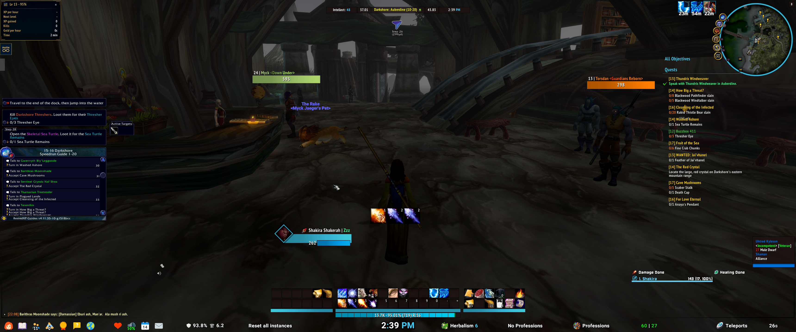
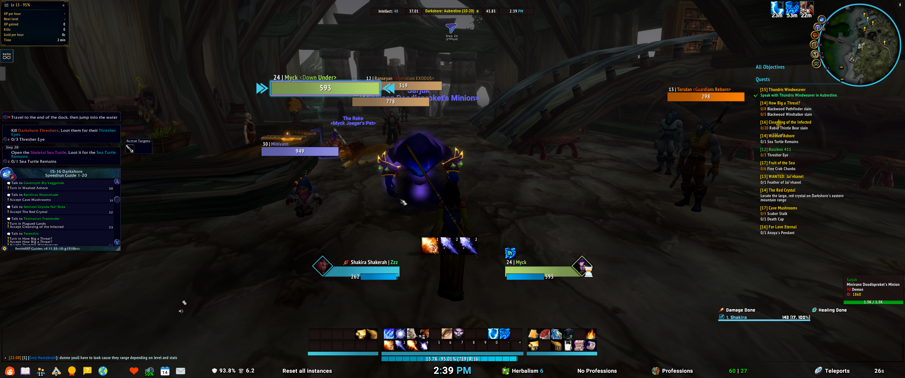
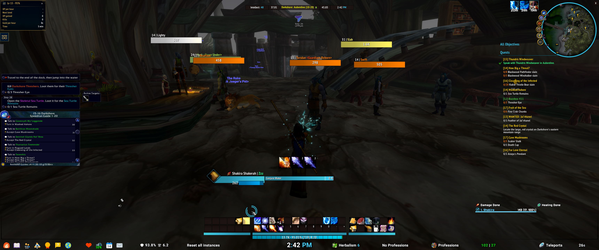

# WoW Forever: ElvUI DPS & Leveling Profile

A clean, dark, information-dense UI for **World of Warcraft: Forever**, built on **ElvUI** with the **mMediaTag & Tools** plugin. It is tuned for levelling and DPS: quest and guide panels on the left, objectives on the right, action bars and cast bar low and central, and a meter and a priority helper that stay out of the way.

This repository holds the import strings and the add-on set I use, so you can copy the whole setup in a few minutes.

## Screenshots

### Normal
Nothing targeted and nothing casting. This is the resting layout: guide and quest panels, minimap, action bars, meter and bottom info bar.

### Targeted
A target selected, with the target frame, nameplates and threat colouring showing.

### Casting
Mid-cast, with the cast bar active above the action bars.

*Screenshots are from a 3440x1440 ultrawide display. If you play at a different resolution, expect to nudge frames in `/ec` (ElvUI toggle anchors).*

## What's in the setup

| Area | What you get |
|---|---|
| **Top bar** | Stats, location and coordinates, and the clock (ElvUI datatexts plus Location Plus) |
| **Left side** | Zygor and RestedXP-style guide panel, quest text and an XP-per-hour tracker |
| **Right side** | Quest objectives list and the minimap, with buff timers above it |
| **Centre bottom** | Player unit frame, cast bar, three action bar blocks and an XP/rep bar |
| **Nameplates** | Class- and threat-coloured plates with level, name, guild and health value |
| **Bottom bar** | Menu icons, durability and bag info, clock, professions, gold and teleports |
| **Combat** | Details! damage and healing meters, Hekili rotation helper, scrolling combat text |

## Add-ons included

The `AddOns/` folder contains the add-ons I run, ready to copy into your game's AddOns directory.

**UI core**
- **ElvUI** (Forever build)
- **ElvUI mMediaTag & Tools** and the **!mMT_MediaPack** media pack
- **ElvUI Eltruism** (EltreumUI)
- **ElvUI Location Plus**

**Combat and raid**
- **Details!** (damage meter) with Compare2, EncounterDetails, RaidCheck, Streamer, TinyThreat and Vanguard plugins
- **Hekili Forever** with class modules
- **BigWigs** and **LittleWigs** (boss and dungeon timers)
- **MikScrollingBattleText** and **NameplateSCT** (combat text)
- **PallyPower**

**Levelling and quality of life**
- **Zygor Guides Viewer** (Forever)
- **RXPGuides**
- **Questie**
- **Immersion**
- **PathForever** (levelling journey, dungeon journal, auction, camping, fishing and mail modules)
- **ForeverDungeonJournal**
- **Baganator** and **Syndicator** (bags and inventory search)
- **Pawn** (gear upgrades)

Several of these are third-party projects with their own licences. Please support the original authors.

## Installation

1. **Back up first.** Copy your `WTF` and `Interface/AddOns` folders somewhere safe.
2. Copy the folders inside this repo's `AddOns/` directory into your WoW Forever `Interface/AddOns/` directory. Check for newer versions of each add-on if you can.
3. Start the game and open ElvUI's installer or `/ec`.
4. Import the strings below.

### Import strings

Open each string file, copy the whole line, and paste it into the matching import box in ElvUI (`/ec` → **Profiles**).

| File | What it is | Where to import |
|---|---|---|
| `Profile.txt` | Main ElvUI profile | `/ec` → Profiles → **Import Profile** |
| `Private.txt` | ElvUI private settings | `/ec` → Profiles → **Import Private** |
| `Global.txt` | ElvUI global settings | `/ec` → Profiles → **Import Global** |
| `Aura Filters.txt` | ElvUI aura filters | `/ec` → Profiles → **Import Filters** |
| `cosmeticbars.txt` | mMediaTag cosmetic bar settings | `/ec` → mMediaTag & Tools → import |
| `blizzard.txt` | Blizzard Edit Mode layout | `Esc` → Edit Mode → **Import** |
| `hekili-style.txt` | Hekili display style | `/hekili` → Toggles/Profiles → **Import** |

After importing, type `/reload`. Import the ElvUI profile first, then the rest.

## Tips

- **Frames in the wrong place?** Run `/ec` and click **Toggle Anchors** to move them, or lower your UI scale.
- **Class colours:** the cosmetic colours follow your class, so the UI will tint to match your character (the screenshots are a mage). 
- **Missing fonts or textures?** Make sure `!mMT_MediaPack` is installed and enabled.
- **A plugin looks different from the screenshots?** Check the add-on is enabled on the character select screen.

## Credits

Thanks to the authors of ElvUI, mMediaTag & Tools, Eltruism, Details!, Hekili, BigWigs, Zygor, RestedXP, Questie and every other add-on listed here. This repository is a personal configuration and is not affiliated with any of them.
